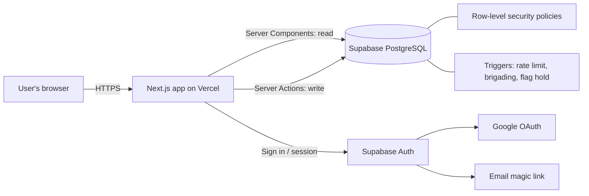
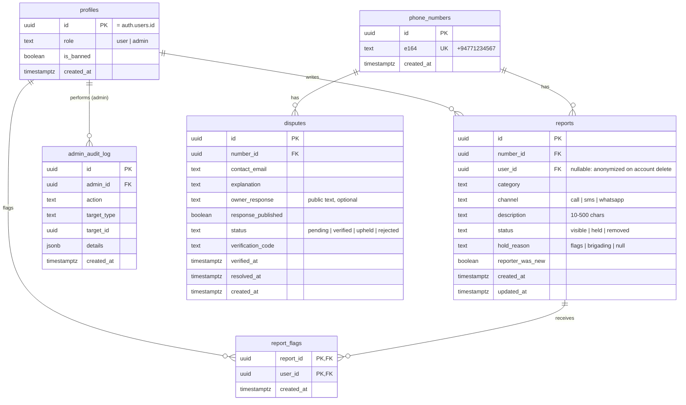
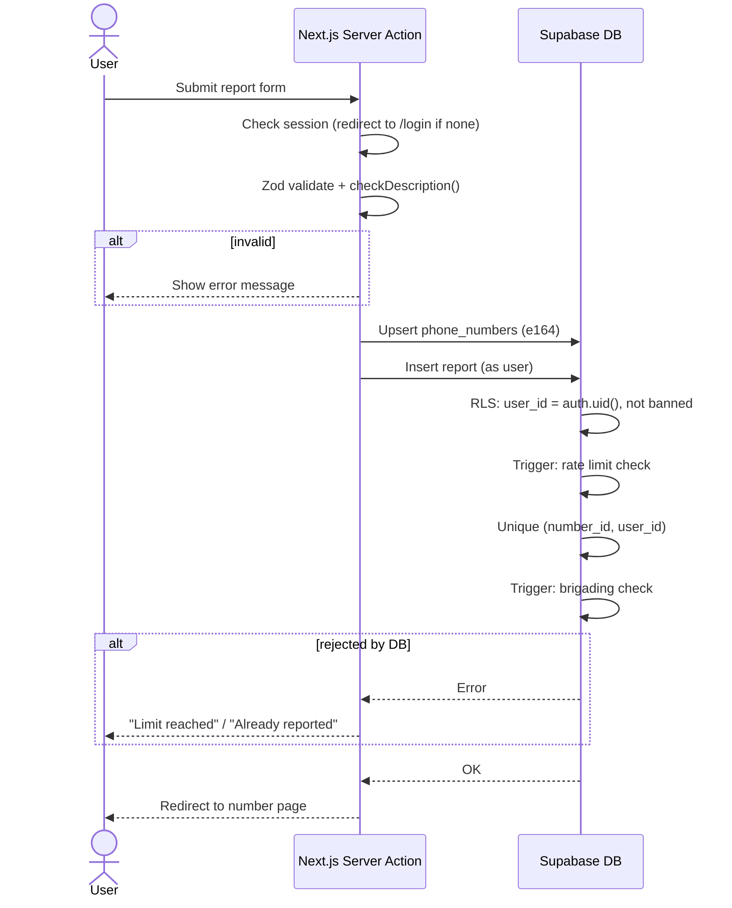
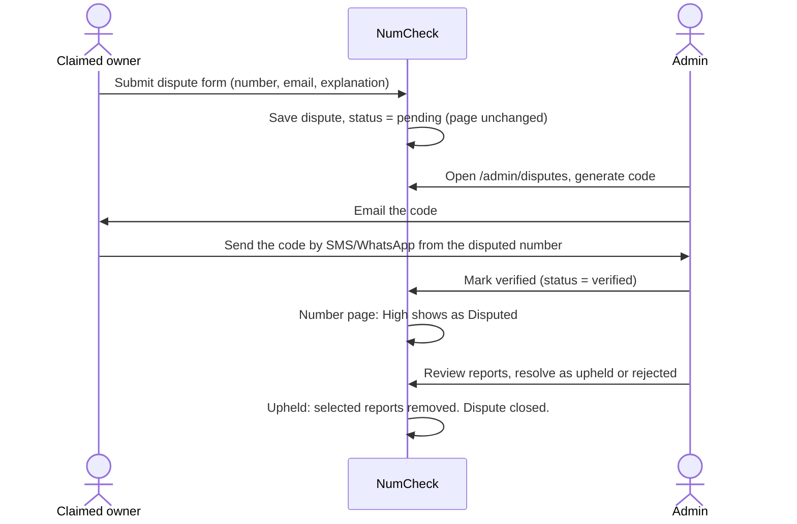

# NumCheck – Design Document

| | |
|---|---|
| **Project** | NumCheck |
| **Version** | 0.1 (Draft) |
| **Date** | 2026-11-27 |
| **Related** | [00-project-charter.md](00-project-charter.md), [01-srs.md](01-srs.md) |

## 1. Purpose

This document describes how NumCheck v1 will be built to meet the requirements in the SRS: the architecture, data model, security model, routes, core logic and UI layout.

## 2. Technology Stack

| Layer | Choice | Reason |
|---|---|---|
| Framework | Next.js (App Router), TypeScript | Server-rendered number pages for SEO (NFR-SEO-01); frontend and backend in one project |
| Styling | Tailwind CSS, tokens from [DESIGN.md](DESIGN.md) | Fast mobile-first UI (NFR-USE-01) |
| Components | shadcn/ui (Radix UI) + lucide icons | Accessible primitives whose code lives in the repo, restyled to DESIGN.md (NFR-ACC-02). See DESIGN.md section 9 |
| Design review | unslop (Claude Code plugin) | Audits every screen for machine-made UI patterns before its pull request. See DESIGN.md section 10 |
| Database | Supabase PostgreSQL | Free tier, row-level security (NFR-SEC-02), triggers for abuse rules |
| Auth | Supabase Auth (Google, email magic link) | FR-AUTH-01, FR-AUTH-02 with no extra service |
| Validation | Zod | Same schema validates forms on the server (NFR-SEC-03) |
| Phone parsing | libphonenumber-js | Reliable normalization to E.164 (FR-SEARCH-01 – 04) |
| Unit tests | Vitest | Fast tests for core logic (NFR-MAINT-01) |
| End-to-end tests | Playwright | Optional; key user flows |
| Hosting | Vercel | Free tier, native Next.js support (NFR-COST-01) |

Versions: latest stable release of each at project setup time.

## 3. Architecture



### 3.1 How a request flows

1. **Reads** (number page, feed) run in Next.js Server Components. They query Supabase on the server and return finished HTML, so search engines can index the content.
2. **Writes** (report, flag, dispute, admin actions) run in Next.js Server Actions. Each action:
   1. checks the user's session,
   2. validates input with Zod (friendly error messages),
   3. writes to the database using the **user's own session**, not an admin key.
3. The database enforces the important rules again with RLS policies, constraints and triggers.

### 3.2 Why rules are enforced in the database too

Supabase exposes the database through a public API, using a key that ships to the browser. Anyone can call that API directly and skip the Next.js app. So every rule that protects other people (one report per number, rate limit, brigading hold, flag hold, admin-only access) must live in the database, where it cannot be bypassed. Server-side validation in Next.js exists to give users clear error messages; the database is the final guard.

### 3.3 Environments

| Environment | Next.js | Database |
|---|---|---|
| Development | `npm run dev` on the developer's machine | Supabase project `numcheck-dev` |
| Production | Vercel | Supabase project `numcheck-prod` |

Database schema changes are kept as SQL migration files in the repository (`supabase/migrations/`) and applied to both projects in the same order.

## 4. Data Model

### 4.1 Entity Relationship Diagram



### 4.2 Table notes

**profiles**
- One row per user, created automatically by a trigger when a user signs up.
- `created_at` is used to decide whether an account is new (< 7 days).

**phone_numbers**
- A row is created only when a number gets its first report. Searching does not create rows, so random searches do not fill the database.
- `e164` is unique, so the same number written in different formats always maps to one row.

**reports**
- `category`: `scam`, `fake_bank`, `lottery`, `spam`, `harassment`, `safe`.
- Unique constraint on `(number_id, user_id)` → one report per user per number (FR-REPORT-03).
- Check constraint on description length (FR-REPORT-02).
- `reporter_was_new` is saved at insert time, so the report keeps its weight even after the account gets older (FR-RISK-02).
- `user_id` uses `ON DELETE SET NULL`, so reports stay but are unlinked when an account is deleted (FR-AUTH-04).
- `status = removed` is a soft delete: the row stays for the audit trail but is never shown.

**report_flags**
- Primary key `(report_id, user_id)` → one flag per user per report (FR-ABUSE-01).

**disputes**
- `contact_email` and `verification_code` are readable by admins only (NFR-PRIV-03).
- `owner_response` is shown on the number page only when `response_published = true` and the status is `verified` or `upheld` (FR-DISPUTE-05).

**admin_audit_log**
- Insert-only. Written by the Server Actions behind every admin action (FR-ADMIN-06).

### 4.3 Database triggers

| Trigger | When | What it does | Requirement |
|---|---|---|---|
| `create_profile` | After a user signs up | Inserts a `profiles` row with role `user` | — |
| `enforce_report_rate_limit` | Before insert on `reports` | Rejects the insert if the user already made 10 reports in the last 24 hours | FR-REPORT-04 |
| `detect_brigading` | After insert on `reports` | If the number now has ≥ 5 reports from new accounts in the last hour, sets those reports to `held` with reason `brigading` | FR-ABUSE-03 |
| `hold_flagged_report` | After insert on `report_flags` | If the report now has ≥ 3 flags and is `visible`, sets it to `held` with reason `flags` | FR-ABUSE-02 |
| `set_updated_at` | Before update on `reports` | Updates `updated_at` | — |

## 5. Security Model

### 5.1 Row-level security policies

| Table | Visitor (anon) | Registered user | Admin |
|---|---|---|---|
| `profiles` | — | Read own row | Read all, update `is_banned` |
| `phone_numbers` | Read | Read; insert (via report flow) | Read |
| `reports` | Read where `status = visible` | Read visible + own; insert own if not banned; update/delete own | Read all, update `status` |
| `report_flags` | — | Insert own if not banned | Read all |
| `disputes` | Insert only | Insert only | Read all, update |
| `admin_audit_log` | — | — | Read, insert |

Notes:
- A user can only set `user_id` to their own id (`user_id = auth.uid()`).
- Users cannot change `status`, `hold_reason` or `reporter_was_new`; these are set by the database.
- The admin check is a SQL function `is_admin()` that reads `profiles.role`, used inside the policies.
- Public pages read the published owner response through a database view that exposes only `number_id` and `owner_response`, never the email or code.

### 5.2 Other security measures

| Measure | Requirement |
|---|---|
| HTTPS everywhere (Vercel default) | NFR-SEC-01 |
| Zod validation in every Server Action | NFR-SEC-03 |
| React escapes text by default; user text is never rendered as raw HTML | NFR-SEC-04 |
| Admin routes check the role on the server, not only in the UI | FR-ADMIN-01 |
| Secret keys (Supabase service role) are never used in user-facing code | NFR-SEC-02 |

## 6. Routes

| Route | Access | Purpose | Requirements |
|---|---|---|---|
| `/` | Public | Search box + recent reports feed | FR-SEARCH, FR-FEED |
| `/number/[digits]` | Public | Number page, e.g. `/number/94771234567` | FR-PAGE |
| `/number/[digits]/report` | Logged in | Report form (create or edit own report) | FR-REPORT |
| `/dispute` | Public | Dispute form, `?number=` pre-filled | FR-DISPUTE-01 |
| `/login` | Public | Google / email sign in | FR-AUTH-01, 02 |
| `/account` | Logged in | Own reports, sign out, delete account | FR-AUTH-03 |
| `/admin` | Admin | Review queue: held reports, flagged reports | FR-ADMIN-02, 03 |
| `/admin/disputes` | Admin | Verify and resolve disputes | FR-ADMIN-05 |
| `/admin/users` | Admin | Ban / unban users | FR-ADMIN-04 |
| `/terms`, `/privacy`, `/guidelines`, `/contact` | Public | Static pages | FR-STATIC |
| `/sitemap.xml` | Public | Numbers with visible reports | NFR-SEO-02 |

Searching on `/` normalizes the input and redirects to `/number/[digits]` (FR-SEARCH-05).

## 7. Core Logic Modules

These are plain TypeScript functions with no database or UI code inside, so they are easy to unit test (NFR-MAINT-01).

### 7.1 `lib/phone.ts` – number normalization

```ts
normalizePhone(input: string): { ok: true; e164: string } | { ok: false; error: string }
toDigits(e164: string): string        // "+94771234567" -> "94771234567" (for URLs)
formatLocal(e164: string): string     // "+94771234567" -> "077 123 4567"
```

- Default country `LK` when no country code is given (FR-SEARCH-02).
- Invalid numbers return an error message (FR-SEARCH-04).

### 7.2 `lib/risk.ts` – risk scoring

```ts
calculateRisk(reports: VisibleReport[], hasVerifiedDispute: boolean, now: Date): RiskResult
// RiskResult = { level: 'unverified' | 'low' | 'medium' | 'high' | 'disputed', netScore: number }
```

Steps (SRS 3.5):
1. If there are fewer than 3 visible reports → `unverified`.
2. For each report: `weight = accountWeight × ageWeight`.
   - `accountWeight` = 0.5 if `reporter_was_new`, else 1.
   - `ageWeight` = 1 (≤ 180 days), 0.5 (181–365 days), 0.25 (older).
3. Negative score = sum of weights of `scam`, `fake_bank`, `lottery`, `harassment`, plus half the weight of `spam`.
4. Positive score = sum of weights of `safe`.
5. `net = negative − positive` → `low` (< 1), `medium` (1 to < 3), `high` (≥ 3).
6. If the level is `high` and `hasVerifiedDispute` → `disputed`.

Risk is calculated **when the page is read**, not stored. Reason: age weights change every day, so a stored score would go out of date.

All weights and thresholds live in `lib/config.ts` (FR-RISK-08).

### 7.3 `lib/content-filter.ts` – description check

```ts
checkDescription(text: string): { ok: true } | { ok: false; reason: 'nic' | 'email' | 'phone' }
```

Blocks (FR-REPORT-05):
- Old NIC: 9 digits followed by `V` or `X`
- New NIC: 12 digits
- Email addresses
- Phone numbers (anything libphonenumber-js finds as a valid number)

### 7.4 `lib/config.ts` – tunable values

| Key | Value |
|---|---|
| `NEW_ACCOUNT_DAYS` | 7 |
| `MIN_REPORTS_FOR_RISK` | 3 |
| `NEW_ACCOUNT_WEIGHT` | 0.5 |
| `AGE_WEIGHTS` | ≤180 days: 1, ≤365 days: 0.5, older: 0.25 |
| `SPAM_WEIGHT` | 0.5 |
| `RISK_MEDIUM_AT` / `RISK_HIGH_AT` | 1 / 3 |
| `DESCRIPTION_MIN` / `DESCRIPTION_MAX` | 10 / 500 |
| `FEED_SIZE` | 20 |

The rate limit (10 per 24h), brigading rule (5 in 1h) and flag hold (3 flags) are enforced in database triggers, so their values live in the migration SQL. `lib/config.ts` keeps the same values for display text (for example "You can submit 10 reports per day"). When one of these values changes, it must be changed in both places.

## 8. Key Flows

### 8.1 Submit a report



### 8.2 Dispute (manual verification)



## 9. UI Design

### 9.1 Principles

The visual design system (colors, type, spacing, components) is defined in [DESIGN.md](DESIGN.md). This section covers layout and behavior only.

- Mobile-first, one column, large tap targets.
- Risk level always shown as **icon + text + color**, never color alone (NFR-ACC-01).
- Neutral, factual wording (FR-PAGE-05).
- All UI text kept in message files (`messages/en.json`) from the start, so adding Sinhala later (NFR-USE-02) only needs a new `si.json`.

### 9.2 Home page `/`

```
┌──────────────────────────────┐
│ NumCheck            [Login]  │
├──────────────────────────────┤
│  Who is calling you?         │
│ ┌──────────────────┐┌──────┐ │
│ │ 077 123 4567     ││Check │ │
│ └──────────────────┘└──────┘ │
├──────────────────────────────┤
│ Recent reports               │
│ ┌──────────────────────────┐ │
│ │ [■ High risk] 077 123... │ │
│ │ Fake bank call · 5m ago  │ │
│ └──────────────────────────┘ │
│ ┌──────────────────────────┐ │
│ │ [○ Unverified] 071 555...│ │
│ │ Lottery/prize · 1h ago   │ │
│ └──────────────────────────┘ │
├──────────────────────────────┤
│ Terms · Privacy · Guidelines │
└──────────────────────────────┘
```

### 9.3 Number page `/number/[digits]`

```
┌──────────────────────────────┐
│ ← NumCheck                   │
├──────────────────────────────┤
│ 077 123 4567                 │
│ +94 77 123 4567              │
│                              │
│ ┌──────────────────────────┐ │
│ │ ■ High risk              │ │
│ │ 12 users reported this   │ │
│ └──────────────────────────┘ │
│                              │
│ Scam ██████████ 8            │
│ Fake bank ███ 3              │
│ Safe █ 1                     │
│                              │
│ [ Report this number ]       │
├──────────────────────────────┤
│ Owner response (if any)      │
├──────────────────────────────┤
│ Reports                      │
│ Scam · Call · 2 days ago     │
│ "Said my bank account was    │
│  locked and asked for OTP"   │
│                    [flag]    │
│ ──────────────────────────── │
│ ...                          │
├──────────────────────────────┤
│ This is my number → Dispute  │
└──────────────────────────────┘
```

### 9.4 Risk level styles

| Level | Icon (lucide) | Label | Color |
|---|---|---|---|
| unverified | `circle-dashed` | Unverified – not enough reports | Gray |
| low | `shield-check` | Low risk | Green |
| medium | `triangle-alert` | Medium risk | Amber |
| high | `octagon-alert` | High risk | Red |
| disputed | `scale` | Disputed – under review | Violet |

Exact color tokens for light and dark themes are in [DESIGN.md](DESIGN.md) section 2.3. Disputed is violet, not blue, because blue is the brand color for buttons and links.

## 10. Project Structure

```
num-check/
├── docs/                     # Charter, SRS, design, PLAN.md
├── messages/
│   └── en.json               # UI text
├── public/
├── src/
│   ├── app/                  # Routes (see section 6)
│   │   ├── page.tsx
│   │   ├── number/[digits]/
│   │   ├── dispute/
│   │   ├── login/
│   │   ├── account/
│   │   ├── admin/
│   │   └── (static)/         # terms, privacy, guidelines, contact
│   ├── components/           # UI components
│   ├── lib/
│   │   ├── phone.ts
│   │   ├── risk.ts
│   │   ├── content-filter.ts
│   │   ├── config.ts
│   │   └── supabase/         # Server and browser clients
│   └── actions/              # Server Actions (report, flag, dispute, admin)
├── supabase/
│   └── migrations/           # SQL: tables, RLS, triggers
├── tests/
│   ├── unit/                 # Vitest
│   └── e2e/                  # Playwright
└── README.md
```

## 11. Testing Approach

| Level | Tool | What |
|---|---|---|
| Unit | Vitest | `phone.ts`, `risk.ts`, `content-filter.ts`: every rule and edge case |
| Database | SQL test scripts | RLS policies and triggers: rate limit, brigading, flag hold, one report per user |
| End-to-end | Playwright | Search → number page; login → report → see it on page |
| Manual | Checklist | Mobile layout at 360px, admin flows, dispute flow |

## 12. Design Decisions

| # | Decision | Alternatives considered | Reason |
|---|---|---|---|
| D1 | Enforce abuse rules in database triggers and RLS | Only in Next.js code | Supabase's public API can be called directly; rules must not be bypassable |
| D2 | Calculate risk on read | Store a score column | Age weights change daily; a stored score goes stale |
| D3 | Create `phone_numbers` rows only on first report | Create on search | Random searches would fill the database with empty rows |
| D4 | Soft delete reports (`status = removed`) | Hard delete | Keeps an audit trail for disputes and legal requests |
| D5 | Save `reporter_was_new` on each report | Look up account age at read time | The weight must reflect the account's age when the report was made |
| D6 | Manual dispute verification via code sent back from the number | SMS OTP | Free; OTP planned for v2 |
| D7 | UI text in message files from day one | Hard-coded text | Makes Sinhala support a small change later |
